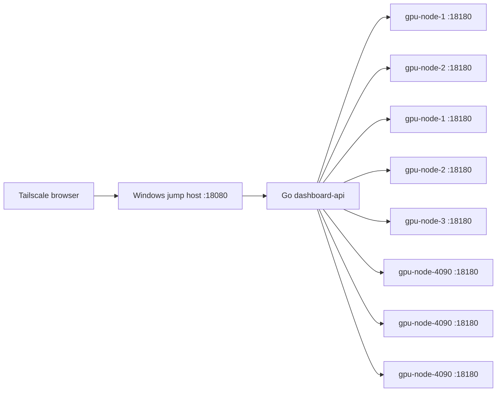

# Lab Server Manager

A modern GPU lab monitoring dashboard for a Windows Tailscale jump host and Linux GPU servers.

The current architecture is front/back separated:

- **Linux Go agent**: runs on each GPU server at `0.0.0.0:18180` and exposes current CPU, memory, disk, cached per-user home usage, GPU, VRAM, users, and process data.
- **Go dashboard API**: runs on the Windows jump host at `0.0.0.0:18080`, concurrently pulls every agent with `X-Agent-Token`, normalizes probe output into JSON, and serves the frontend build.
- **React dashboard web**: Vite + React + TypeScript frontend with a dark SaaS-style progressive dashboard, actionable attention panel, collapsible per-host details, and per-user process tables.

Current lab dashboard URL: `http://100.64.0.1:18080/`

## Repository Layout

```text
apps/dashboard-web/              React/Vite dashboard frontend
cmd/dashboard-api/               Go API and static frontend server for the Windows jump host
cmd/gpu-status-agent/            Go HTTP agent for each Linux host
config/hosts.example.json        Example host inventory and dashboard settings
jump_host/gpu_dashboard.py       Legacy single-file Python dashboard kept for rollback
jump_host/start_gpu_dashboard.cmd Start the Go dashboard API on Windows
jump_host/start_gpu_tunnels.cmd  Legacy no-op; direct mode does not need tunnels
jump_host/install_scheduled_tasks.cmd Register dashboard on Windows logon
linux_agent/dashboard_probe.sh   Probe script using nvidia-smi, df, free, ps, /proc
linux_agent/install_agent.sh     Install/start helper for Linux hosts
linux_agent/user_disk_cache_updater.sh Cached low-priority per-user /home disk scanner
tools/build_agent_windows.ps1    Build Linux agent and Windows dashboard API binaries
tools/deploy_from_windows.ps1    Deploy agents and dashboard files from Windows
```

## Quick Start

1. Copy this project to the Windows jump host.
2. Put the real host list and token in `config/hosts.json`. You can start from `config/hosts.example.json`.
3. Build the frontend:

```powershell
cd apps\dashboard-web
npm install
npm run build
```

4. Build Go binaries from the project root:

```powershell
.\tools\build_agent_windows.ps1
```

5. Install the Linux agent on each server.

**Option A (Manual Copy via SCP)**:
```bash
mkdir -p /home/g24tka12/lab-server-manager
scp dist/gpu-status-agent-linux-amd64 linux_agent/dashboard_probe.sh linux_agent/install_agent.sh linux_agent/user_disk_cache_updater.sh g24tka12@HOST:/home/g24tka12/lab-server-manager/
ssh g24tka12@HOST 'mv /home/g24tka12/lab-server-manager/gpu-status-agent-linux-amd64 /home/g24tka12/lab-server-manager/gpu-status-agent && bash /home/g24tka12/lab-server-manager/install_agent.sh'
```

**Option B (One-Click HTTP Bootstrap Deployment)**:
If the dashboard API is already running on the jump host, you can deploy the agent on any remote GPU server with a single command. Run the following command on the remote server (replace `<JUMP-HOST-IP>` with the jump host's Tailscale or local IP):
```bash
curl -sSL http://<JUMP-HOST-IP>:18080/agent/install_agent.sh | AGENT_TOKEN="suzuki-lab" DOWNLOAD_URL="http://<JUMP-HOST-IP>:18080/agent" bash
```

6. On the Windows jump host, run:

```cmd
jump_host\start_gpu_dashboard.cmd
```

7. Open `http://100.64.0.1:18080/` from a Tailscale client.

## Configuration

`config/hosts.json` is ignored by git and should contain the real token:

```json
{
  "dashboard": {
    "bind_host": "0.0.0.0",
    "bind_port": 18080,
    "poll_seconds": 2,
    "agent_port": 18180,
    "agent_token": "set-real-token-here"
  },
  "hosts": [
    { "name": "gpu-node-1", "ip": "10.0.0.11", "group": "A6000" }
  ]
}
```

The dashboard token can also be supplied by the Windows environment variable `DASHBOARD_AGENT_TOKEN`, which overrides the config file.

## Autostart on the Windows Jump Host

Run this once on the Windows jump host:

```cmd
jump_host\install_scheduled_tasks.cmd
```

It creates or updates the user-level scheduled task `GPUStatusDashboard` and disables the legacy `GPUStatusTunnels` task if it exists.

## Data Flow



## Network & SSH Configuration

The lab network consists of a Windows jump host reachable via Tailscale, and several internal Linux GPU hosts.

### Host Connection Map

* **Jump Host (Windows)**:
  * **Tailscale IP**: `100.64.0.1`
  * **Windows Username**: `James`
  * **SSH Key Path**: `~/.ssh/codex_windows_tailscale_lan_ed25519`
* **Internal GPU Servers (Linux/Ubuntu)**:
  * **Internal Username**: `g24tka12`
  * **Hosts & IPs**:
    * `gpu-node-1` / `10.0.0.11` (Observed hostname: `gpu-node-1`)
    * `gpu-node-2` / `10.0.0.12` (Observed hostname: `gpu-node-2`)
    * `gpu-node-1` / `10.0.1.11` (Observed hostname: `gpu-node-1`)
    * `gpu-node-2` / `10.0.1.12` (Observed hostname: `gpu-node-2`)
    * `gpu-node-3` / `10.0.0.14` (Observed hostname: `gpu-node-3.local`)
    * `gpu-node-4090` / `10.0.0.13` (Observed hostname: `4090-224`)
    * `gpu-node-4090` / `10.0.1.21` (Observed hostname: `gpu-node-4090`)
    * `gpu-node-4090` / `10.0.1.22` (Observed hostname: `gpu-node-4090.local`)

### SSH config Template

To configure transparent proxy jumping through the Windows jump host, add this template to your local `~/.ssh/config`:

```text
# Windows Jump Host
Host windows-jump
    HostName 100.64.0.1
    User James
    # IdentityFile ~/.ssh/codex_windows_tailscale_lan_ed25519

# Internal Linux Hosts
Host gpu-node-1
    HostName 10.0.0.11
    User g24tka12
    ProxyJump windows-jump

Host gpu-node-2
    HostName 10.0.0.12
    User g24tka12
    ProxyJump windows-jump

Host gpu-node-1
    HostName 10.0.1.11
    User g24tka12
    ProxyJump windows-jump

Host gpu-node-2
    HostName 10.0.1.12
    User g24tka12
    ProxyJump windows-jump

Host gpu-node-3
    HostName 10.0.0.14
    User g24tka12
    ProxyJump windows-jump

Host gpu-node-4090
    HostName 10.0.0.13
    User g24tka12
    ProxyJump windows-jump

Host gpu-node-4090
    HostName 10.0.1.23
    User g24tka12
    ProxyJump windows-jump

Host gpu-node-4090
    HostName 10.0.1.24
    User g24tka12
    ProxyJump windows-jump
```

Once configured, you can connect directly to any GPU server (e.g. `ssh gpu-node-1`) or run commands non-interactively using public key authentication:
```powershell
ssh -o BatchMode=yes gpu-node-1 "hostname && whoami && uname -a"
```

### Ollama Port Forwarding Map

All GPU hosts run the Ollama binary at `~/bin/ollama` listening on local/LAN port `11433`. The Windows Tailscale jump host exposes these endpoints via `netsh interface portproxy` on port range `11441-11448`:

* `100.64.0.1:11441` &rarr; `gpu-node-1` (`10.0.0.11:11433`)
* `100.64.0.1:11442` &rarr; `gpu-node-2` (`10.0.0.12:11433`)
* `100.64.0.1:11443` &rarr; `gpu-node-1` (`10.0.1.11:11433`)
* `100.64.0.1:11444` &rarr; `gpu-node-2` (`10.0.1.12:11433`)
* `100.64.0.1:11445` &rarr; `gpu-node-3` (`10.0.0.14:11433`)
* `100.64.0.1:11446` &rarr; `gpu-node-4090` (`10.0.0.13:11433`)
* `100.64.0.1:11447` &rarr; `gpu-node-4090` (`10.0.1.25:11433`)
* `100.64.0.1:11448` &rarr; `gpu-node-4090` (`10.0.1.26:11433`)

Verify connectivity from your local client:
```powershell
curl.exe http://100.64.0.1:11441/api/tags
```

### vLLM Port Forwarding Map

Additional vLLM model servers are exposed on separate ports via the same jump host:

* `100.64.0.1:11455` &rarr; `gpu-node-3` (`10.0.0.14:11444`) — **DiffusionGemma 26B-A4B FP8** (vLLM, OpenAI-compatible API)

Verify connectivity:
```powershell
curl.exe http://100.64.0.1:11455/v1/models
```

### RDP Access
* **Jump Host**: `mstsc /v:100.64.0.1` (log in as `James`).
* The internal Linux hosts are Linux/Ubuntu systems; do not use RDP for them unless a desktop service is manually configured.

## Notes

- The Linux agent binds to `0.0.0.0:18180` in direct pull mode and requires `X-Agent-Token` when `AGENT_TOKEN` is set.
- The React frontend updates data in place. Rows and metric cells transition only when their values change.
- Per-user `/home` usage is collected by a low-priority background updater and read from cache during status requests, so `/status` no longer runs expensive `du` scans.
- If a host's agent is unreachable, the dashboard marks it `down` and shows the HTTP or agent error.
- If a host's agent is reachable but `nvidia-smi`/NVML fails, the host remains online and shows a GPU driver warning while CPU, memory, disk, users, and processes continue to render.

