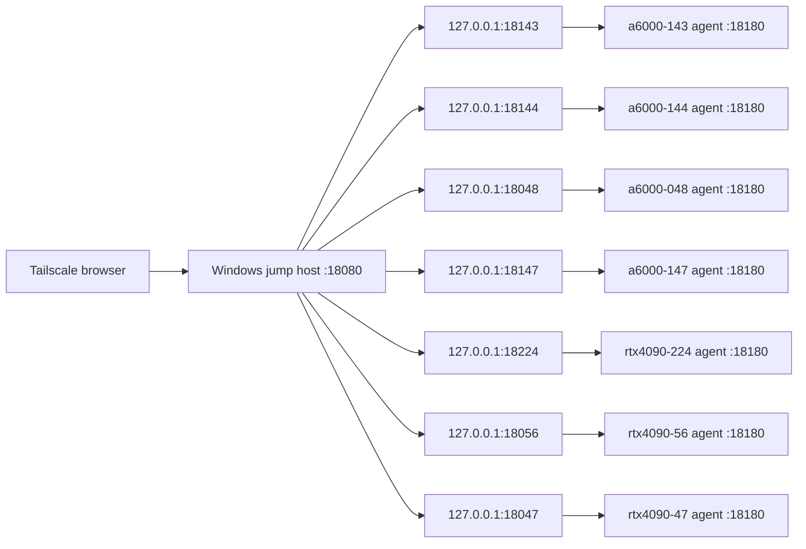

# Lab Server Manager

A lightweight GPU lab monitoring dashboard for a Windows Tailscale jump host and Linux GPU servers.

The project has three pieces:

- Linux agent: runs on each GPU server at `127.0.0.1:18180` and exposes current CPU, memory, disk, per-user home usage, GPU, VRAM, users, and process data.
- SSH tunnels: run on the Windows jump host and map one local port per server to the Linux agent.
- Dashboard: runs on the Windows jump host at `0.0.0.0:18080` and reads the tunnel ports every 2 seconds.

Current lab dashboard URL: `http://100.99.99.99:18080/`

## Repository Layout

```text
config/hosts.example.json        Example host inventory and tunnel ports
jump_host/gpu_dashboard.py       Dashboard HTTP server and frontend UI
jump_host/start_gpu_dashboard.cmd Start dashboard on Windows jump host
jump_host/start_gpu_tunnels.cmd  Start persistent SSH local tunnels
jump_host/install_scheduled_tasks.cmd Register dashboard/tunnels on Windows logon
linux_agent/gpu_status_agent.py  Local HTTP agent for each Linux host
linux_agent/dashboard_probe.sh   Probe script using nvidia-smi, free, ps, /proc
linux_agent/install_agent.sh     Install/start helper for Linux hosts
tools/check_status.ps1           Check jump dashboard and per-host tunnel APIs
tools/deploy_from_windows.ps1    Copy agent files to Linux hosts and project files to jump host
```

## Quick Start

1. Copy this project to the Windows jump host.
2. Put your real host list in `config/hosts.json`. You can start from `config/hosts.example.json`.
3. Install the Linux agent on each server:

```bash
mkdir -p /home/g24tka12/lab-server-manager
scp linux_agent/gpu_status_agent.py linux_agent/dashboard_probe.sh linux_agent/install_agent.sh g24tka12@HOST:/home/g24tka12/lab-server-manager/
ssh g24tka12@HOST 'bash /home/g24tka12/lab-server-manager/install_agent.sh'
```

4. On the Windows jump host, run:

```cmd
jump_host\start_gpu_tunnels.cmd
jump_host\start_gpu_dashboard.cmd
```

5. Open `http://100.99.99.99:18080/` from a Tailscale client.

## Autostart on the Windows Jump Host

Run this once on the Windows jump host:

```cmd
jump_host\install_scheduled_tasks.cmd
```

It creates two user-level scheduled tasks:

- `GPUStatusTunnels`: starts SSH local tunnels at logon.
- `GPUStatusDashboard`: starts the dashboard at logon.

## Data Flow



## Notes

- The Linux agent binds only to `127.0.0.1` by default. It is exposed only through SSH tunnels.
- The dashboard updates data in place. It does not reload the full page every polling cycle.
- The process list is grouped by user and uses light per-user colors for readability.\n- Disk volume usage is collected with `df`; per-user `/home` usage is collected with `du` and cached for 5 minutes to avoid filesystem pressure.
- If a host is unreachable, the dashboard shows it as `down` with the tunnel or HTTP error.


